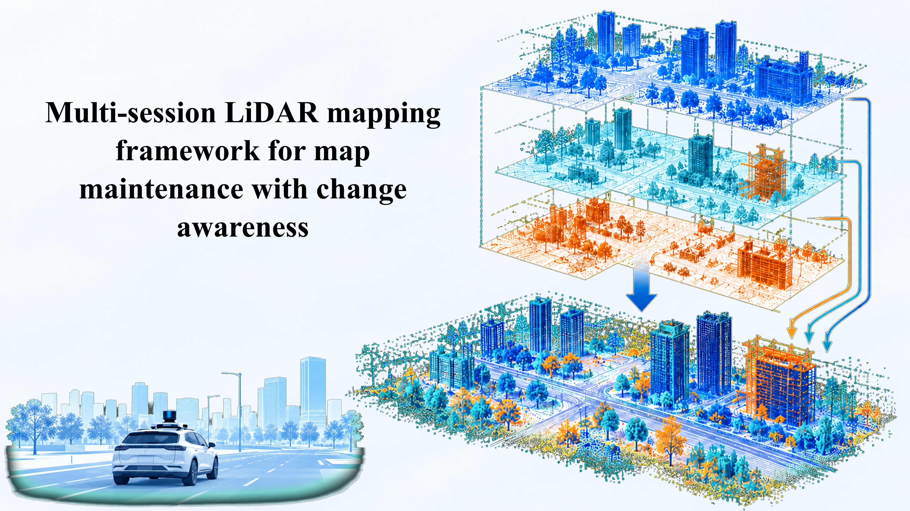

# Large-Scale Multi-Session Mapping

**A Framework for Large-Scale and Multi-Session LiDAR Mapping**

  

  
  
  

## Overview

This repository presents our ongoing research on **large-scale multi-session LiDAR mapping**, focusing on building geometrically consistent maps from multiple mapping sessions.

The project investigates challenges related to long-term mapping, cross-session alignment, and spatial consistency in complex real-world environments.

Our goal is to develop a robust and scalable mapping framework capable of integrating observations collected across different sessions into a unified spatial representation.

## Research Highlights

- **Large-Scale Mapping:** Constructing consistent 3D maps across extensive environments.
- **Multi-Session Integration:** Combining LiDAR observations collected at different times.
- **Robust Registration:** Improving alignment and geometric consistency between mapping sessions.
- **Real-World Applications:** Supporting long-term robotic mapping and environmental monitoring.

## Visualization

The figure above illustrates an example of our multi-session mapping results.

Additional experimental results, quantitative evaluations, and visualizations will be provided as the research progresses.

## Publication

> **Paper in Preparation**
>
> The corresponding manuscript is currently being prepared for submission to a peer-reviewed journal.
>
> The paper, technical details, experimental results, and implementation will be updated as they become available.

## Code Availability

The source code is not publicly available at this stage.

We plan to update this repository with further documentation and research materials as the project develops. Code release details will be announced in a future update.

## Contact

For research discussions or potential collaborations, feel free to reach out through [GitHub](https://github.com/Shidabot).

---

  <i>Stay tuned for upcoming updates!</i>

